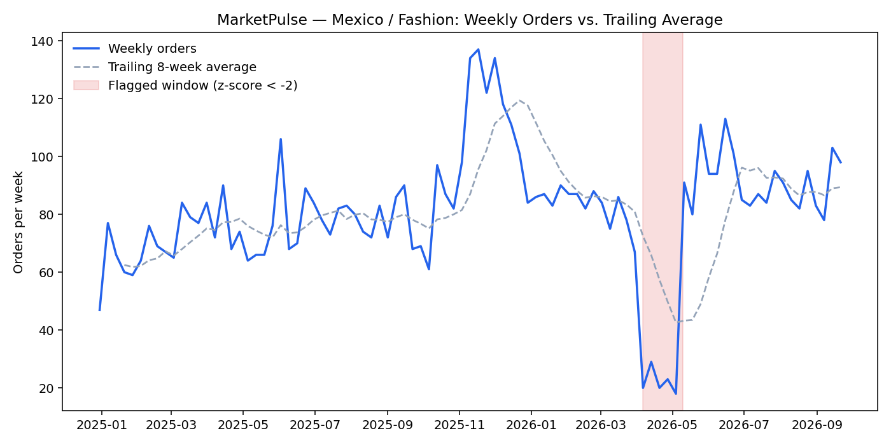
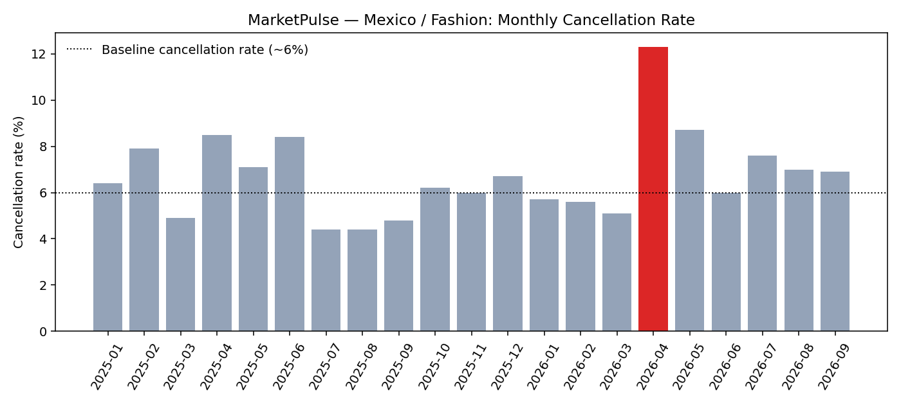

# MarketPulse — Sales Performance & Anomaly Investigation

> **MarketPulse is a fictional e-commerce marketplace.** Every seller, order,
> and number in this repository comes from a synthetic dataset
> ([`data/generate_data.py`](data/generate_data.py), fixed random seed) — no
> real company, no real employer data. This is a self-contained demo of a
> SQL + Python analytics workflow, built to show the process end to end:
> KPI reporting → an automated anomaly flag → root-cause analysis →
> an AI-drafted incident summary.

## The business problem

MarketPulse's commercial team reviews revenue, category mix, and seller
performance on a weekly cadence. The real question an analytics team has to
answer isn't just "what's the number" — it's **"did something just break,
and how do we know the difference between a real incident and normal
seasonal noise, fast enough to act on it?"**

## What's in here

| Layer | File | What it does |
|---|---|---|
| Data | [`data/generate_data.py`](data/generate_data.py) | Generates ~170k synthetic orders (42 sellers, 4 regions, 6 categories, 21 months) into a SQLite DB, with a deliberately injected operational incident to find |
| SQL | [`sql/analysis.sql`](sql/analysis.sql) | 5 queries: monthly KPIs, month-over-month growth (window functions), a seller leaderboard (`RANK() OVER`), a rolling z-score anomaly detector (CTEs + window functions), and a root-cause cancellation-rate check |
| Analysis | [`notebook/analysis.ipynb`](notebook/analysis.ipynb) | The same analysis in pandas, with charts, walking through the investigation step by step |
| AI agent | [`ai_agent/insight_agent.py`](ai_agent/insight_agent.py) | Takes the computed summary stats and asks Claude to draft the written incident summary a business stakeholder would read |

## Key finding

The SQL anomaly detector (query 4) flags **14 weeks** across the whole
dataset. Thirteen of them cluster in the same calendar week — late
December, right after the holiday demand spike — which is expected seasonal
reversion, not an incident. **One flagged week stands alone, outside that
cluster: Mexico / Fashion, the week of 2026-04-06.**



Volume alone doesn't say why. Cross-referencing the cancellation rate for
that same segment is the step that turns a flagged chart into an actual
diagnosis:



Orders in the flagged week dropped 75% below the 8-week baseline (80.9 →
20 orders/week) **while the cancellation rate for the same segment roughly
doubled** (6.1% → 12.3%). Volume down + cancellations up, isolated to one
region × category and not shared by the December cluster, points to a
fulfillment-side failure (most likely a carrier or logistics-partner issue)
rather than a demand or pricing problem — and gives the operations team a
specific place to look instead of a vague "revenue is down" alert.

## How to run it

```bash
pip install -r requirements.txt

# 1. Generate the synthetic dataset (reproducible via a fixed seed)
python data/generate_data.py

# 2. Re-run the SQL queries directly
sqlite3 data/marketpulse.db < sql/analysis.sql

# 3. Regenerate the notebook + figures from scratch
python notebook/build_notebook.py        # writes notebook/analysis.ipynb
python notebook/run_analysis.py          # writes notebook/figures/*.png

# 4. Optional: the AI insight agent (needs your own Anthropic API key)
export ANTHROPIC_API_KEY=sk-...
python ai_agent/insight_agent.py
```

## Why this exists

This project exists to demonstrate the same analytics workflow I use in
real BI/Analyst work — KPI design, SQL root-cause analysis, anomaly
detection, and AI-augmented analysis (Claude Code) — on a dataset that
contains nothing from any real employer. See
[lucas-piccoli on LinkedIn](https://www.linkedin.com/in/lucas-piccoli/).
